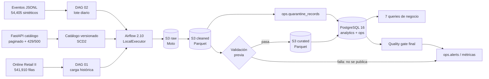
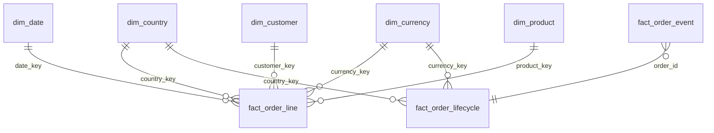

<h1 align="center">Mercado Nube</h1>

<p align="center">
  <strong>Plataforma de datos local-first para ventas, eventos de pedido y catálogo versionado.</strong><br/>
  De la ingesta a las preguntas de negocio: <code>raw → cleaned → curated</code>, modelo dimensional con SCD2,
  calidad con cuarentena y orquestación con Airflow.
</p>

<p align="center">
  
  
  
  
  
  
</p>

---

> [!IMPORTANT]
> **Demo local, sin gasto en AWS** (permitido por el anexo del simulacro). Todo el flujo se ejecuta con Docker, Moto (emulación S3) y PostgreSQL.
> La infraestructura AWS está en Terraform: pasa `fmt` y `validate` y se probó con `apply` contra Moto, pero **nunca se aplicó en una cuenta real**.
> La versión Redshift del modelo está en `sql/redshift/`.

## Lo que demuestra este proyecto

- Ingesta de un histórico de ventas, 7 lotes diarios de eventos y un catálogo versionado desde una API.
- Data lake compatible con S3 y organizado por capas `raw → cleaned → curated` (Parquet).
- Airflow con dos DAGs: carga histórica y lote diario (usa la fecha lógica `ds`, admite backfill por intervalo).
- **Validación antes de publicar** (write-audit-publish) y quality gate final después de publicar.
- Modelo dimensional en PostgreSQL con SCD2 y miembros desconocidos explícitos; DDL equivalente para Redshift.
- Cuarentena con motivo, deduplicación determinista y control de conflictos.
- Idempotencia ante reruns, recuperación tras fallas y reproceso de eventos tardíos.
- Siete consultas de negocio versionadas con evidencia de cada resultado.
- Terraform con IAM de mínimo privilegio, alarmas de CloudWatch, Redshift Serverless y presupuesto opcionales.

## Resultados verificables

| Componente | Resultado local |
|---|---:|
| Histórico leído | **541,910** filas |
| Hechos de línea de factura | **534,130** |
| Eventos leídos (7 lotes) | **54,405** |
| Eventos publicados | **53,783** |
| Órdenes en lifecycle | **27,000** |
| Versiones SCD2 de producto | **5,312** |
| Productos corrientes | **3,958** |
| Eventos tardíos | **1,594** (2.96%) |
| Filas en cuarentena | **2,602** |
| Checks de calidad | **216/216 pass** |
| Tests unitarios | **20/20 pass** |
| Terraform | `fmt` + `validate` OK, `apply` probado contra Moto |

Reconciliación:

```text
Histórico: 541,910 leídas = 2,517 rechazadas + 5,263 duplicadas + 534,130 publicadas
Eventos:    54,405 leídos =    85 rechazados +   537 duplicados +  53,783 publicados
```

La evidencia completa está en [`docs/evidencia.md`](docs/evidencia.md) y en los archivos crudos de [`docs/evidence/`](docs/evidence/).

## Arquitectura



Diagrama de credenciales y accesos: [`docs/arquitectura.md`](docs/arquitectura.md#credenciales-y-accesos).

### Equivalencia local → AWS

| Local | Referencia AWS | Decisión |
|---|---|---|
| Moto S3 | S3 versionado, SSE-S3 y lifecycle | Mismo contrato de llaves y cliente `boto3` |
| PostgreSQL 16 | Redshift Serverless | DDL propio en `sql/redshift/` (DISTKEY/SORTKEY, SUPER) y carga COPY + MERGE |
| Airflow LocalExecutor | MWAA | Mismos DAGs; schedule por `DAILY_SCHEDULE` |
| `.env` local | Secrets Manager + rol de ejecución (STS) | Sin access keys en código ni imágenes |
| `ops.alerts` + log `METRIC` | CloudWatch métricas + alarmas → SNS | `src/metrics.py` publica si `CLOUDWATCH_METRICS_ENABLED=true` |
| FastAPI local | API real / Lambda | Simula paginación, rate limit y errores transitorios |

## Stack

| Capa | Tecnología |
|---|---|
| Orquestación | Apache Airflow 2.10, `LocalExecutor` |
| Procesamiento | Python, pandas, PyArrow |
| Data lake | S3 compatible con Moto, Parquet, checksums SHA-256 |
| Warehouse | PostgreSQL 16 (`staging`, `analytics`, `ops`); Redshift en `sql/redshift/` |
| API de catálogo | FastAPI + Uvicorn |
| Infraestructura como código | Terraform + AWS provider 5.x |
| Pruebas | pytest (unitarias e integración) |
| Contenedores | Docker Compose |

## Inicio rápido (una sola instrucción)

Requisitos: Docker Desktop con Compose v2, PowerShell 7+ y ~4 GB de RAM libre.

```powershell
.\scripts\run_demo.ps1
```

El script:

1. crea `.env` desde `.env.example` con contraseñas y claves aleatorias si no existe (`.env` no se versiona);
2. levanta el stack y espera los healthchecks;
3. ejecuta la carga histórica y los 7 lotes diarios (2026-10-20 a 2026-10-26);
4. ejecuta las 7 consultas y guarda el resultado en `docs/evidence/sql_results.txt`.

Es idempotente: si un lote ya está publicado, lo omite. Opciones: `-ForceDaily`, `-IncludeHistorical`, `-SkipBuild`, `-StartDate`, `-EndDate`.

### Servicios locales

| Servicio | URL / conexión | Credenciales |
|---|---|---|
| Airflow | <http://localhost:8088> | `admin` / valor de `AIRFLOW_ADMIN_PASSWORD` en `.env` |
| API de catálogo | <http://localhost:8001/docs> | — |
| PostgreSQL | `localhost:5433`, DB `mercado_nube` | `mn_app` / valor de `WAREHOUSE_PASSWORD` en `.env` |
| Adminer | <http://localhost:8082> | Usar conexión a `postgres` |
| Moto S3 | <http://localhost:9002> | `test` / `test` (dummy) |

### Ejecutar lotes a mano, backfill y recuperación

```powershell
# Un lote puntual
docker exec mn_airflow airflow dags trigger 02_daily_events --conf '{"ingest_date":"2026-10-22"}'

# Backfill / replay de un intervalo sin editar código
.\scripts\backfill.ps1 -Start 2026-10-20 -End 2026-10-26

# Falla simulada después de escribir en S3 y recuperación idempotente
.\scripts\demo_fail_recover.ps1
```

Sin `--conf`, el DAG diario usa la fecha lógica de Airflow (`ds`); con `DAILY_SCHEDULE=@daily` en `.env` corre solo cada día.

## Datos incluidos y capas

El repositorio incluye los datos de entrada para que la demo sea reproducible sin descargas adicionales:

- histórico público **Online Retail II** (UCI Machine Learning Repository, hoja "Year 2010-2011", licencia **CC BY 4.0**);
- 7 lotes sintéticos de eventos en JSONL (semilla 42), con duplicados, conflictos, eventos tardíos e inválidos;
- versiones v1, v2 y v3 del catálogo.

Los scripts de `scripts/` permiten regenerarlos de forma determinista.

```text
raw/
  source=orders_historical/ingest_date=YYYY-MM-DD/batch_id=.../order_lines.csv
  source=order_events/ingest_date=YYYY-MM-DD/batch_id=.../events.jsonl
  source=catalog/ingest_date=YYYY-MM-DD/batch_id=.../catalog_vN.json

cleaned/
  source=.../batch_id=.../order_lines.parquet
  source=.../batch_id=.../events.parquet
  source=.../batch_id=.../quarantine.parquet
  source=.../batch_id=.../duplicates.parquet

curated/
  table=fact_order_event/...
  table=fact_order_lifecycle/...
  table=dim_product/...
```

## Modelo dimensional



- **`dim_product`**: SCD2 por `sku` con `valid_from`, `valid_to`, `is_current`, `record_hash` y `catalog_version`.
- **`dim_customer`**: histórico más miembro desconocido explícito (`customer_key = -1`).
- **`fact_order_line`**: grano línea de factura; ventas y devoluciones con montos en USD.
- **`fact_order_event`**: grano evento, `UNIQUE(source, event_id)`, `is_late` y `late_hours`.
- **`fact_order_lifecycle`**: una fila por orden, recalculada con todo el historial de eventos.
- **Tablas operativas**: cuarentena, métricas por lote/capa, manifiestos, checksums, calidad y alertas.

Detalle: [`docs/modelo_datos.md`](docs/modelo_datos.md). Decisiones: [`docs/decisiones.md`](docs/decisiones.md).

## Calidad, idempotencia y eventos tardíos

### Checks de calidad

| Dominio | Validación previa (antes de publicar) | Quality gate final | Resultado |
|---|---:|---:|---|
| Histórico (1 lote) | 4 | 9 | 13/13 pass |
| Eventos (7 lotes) | 4 por lote | 13 por lote | 119/119 pass |
| Catálogo (7 lotes) | 4 por lote | 8 por lote | 84/84 pass |
| **Total** | | | **216/216** |

- **Validación previa:** tasas de rechazo y duplicados bajo umbral y cuadre `leídas = rechazadas + duplicadas + limpias`. Si falla, el lote **no se publica**.
- **Quality gate final:** contratos, reconciliación, integridad de `event_id`, joins a dimensiones, cobertura de lifecycle, frescura y consistencia SCD2. Si falla, el run queda en `failed` y se registra una alerta.
- **Reglas destacadas:** coherencia país-moneda (`country_currency_mismatch`), precio no positivo, SKU ausente, fechas inválidas y conflicto de `event_id`.

### Idempotencia

- `batch_id` determinista: `historical_<fecha>`, `events_<fecha>`, `catalog_<fecha>_v<versión>`.
- S3 sobrescribe la misma llave y registra checksum SHA-256 en `ops.batch_manifest`.
- Histórico: `DELETE` por `batch_id` + inserción transaccional.
- Eventos: `UNIQUE(source, event_id)` + `ON CONFLICT`.
- Lifecycle: upsert por `(source, order_id)`, recalculado con todo el historial.
- Un rerun del mismo lote no duplica hechos ni altera los checksums de ese lote.

### Eventos tardíos

Un evento es tardío cuando `ingested_at - event_time_utc > 24 h`. Al publicar, se recalculan **todas** las órdenes afectadas, no solo el evento nuevo. Resultado: **1,594 eventos tardíos (2.96%)** en **1,579 órdenes**.

Detalle: [`docs/calidad.md`](docs/calidad.md).

## Preguntas de negocio

Las siete consultas están en [`sql/queries/`](sql/queries/) y sus resultados completos en
[`docs/evidence/sql_results.txt`](docs/evidence/sql_results.txt).

| # | Pregunta | Hallazgo principal |
|---|---|---|
| 1 | Ventas, devoluciones y neto por mes/país/moneda (USD) | Histórico (GBP) y eventos (COP/MXN/PEN) en una sola consulta |
| 2 | Ingresos y proporción de devoluciones por categoría | General lidera ingresos; Stationery tiene 25.6% de devoluciones |
| 3 | Top 10 SKU por venta neta y por devoluciones | `22423` lidera ventas; `23843` es una devolución total (100%) |
| 4 | Tiempo a pago y cancelación | ~18 h de mediana; cancelación entre 7.7% y 7.9% por país |
| 5 | Eventos tardíos y reprocesamiento | 1,594 tardíos; 1,579 órdenes recalculadas |
| 6 | Rechazo por fuente, motivo y últimos 7 lotes | Histórico 0.46% (`invalid_price`); eventos 0.16% |
| 7 | Productos con atributos modificados | 965 de 3,958 SKU cambiaron; historial SCD2 completo |

Limitación: el histórico es 2010–2011 y los eventos 2026; se reportan como series separadas.

## Evidencia y verificación

| Evidencia | Archivo |
|---|---|
| Conteos finales y métricas por lote | [`final_counts.txt`](docs/evidence/final_counts.txt) |
| Resumen de verificación | [`verify.txt`](docs/evidence/verify.txt) |
| Tests unitarios | [`pytest_unit.txt`](docs/evidence/pytest_unit.txt) |
| Tests de integración | [`pytest_integration.txt`](docs/evidence/pytest_integration.txt) |
| Prueba de idempotencia | [`idempotency.txt`](docs/evidence/idempotency.txt) |
| Falla y recuperación | [`failure_recovery.txt`](docs/evidence/failure_recovery.txt) |
| Resultados SQL | [`sql_results.txt`](docs/evidence/sql_results.txt) |
| SSE-S3 local | [`s3_sse.txt`](docs/evidence/s3_sse.txt) |
| Terraform | [`terraform_validate.txt`](docs/evidence/terraform_validate.txt) |

```powershell
# Tests unitarios
docker exec mn_airflow python -m pytest tests -m "not integration" -q

# Tests completos + queries (requiere stack y datos)
docker exec -e RUN_INTEGRATION_TESTS=1 mn_airflow python -m pytest tests -q

# Conteos y checks de calidad
.\scripts\verify.ps1

# Regenerar evidencia SQL
.\scripts\run_queries.ps1
```

## AWS y Terraform

La carpeta [`terraform/`](terraform/) describe la infraestructura AWS:

- bucket S3 por ambiente con versionado, SSE-S3, bloqueo público, TLS obligatorio y lifecycle por capa;
- rol de ejecución de MWAA con mínimo privilegio (escribe solo en `raw/`, `cleaned/`, `curated/`) y rol de despliegue separado;
- log groups de MWAA con retención, alarmas de errores, aumento de rechazos, fallo de calidad y retraso de datos → SNS;
- MWAA (`enable_mwaa`) y Redshift Serverless (`enable_redshift`) opcionales, apagados por defecto;
- AWS Budgets y suscripción de correo con `alert_email`.

```powershell
cd terraform
terraform init -backend=false
terraform fmt -check
terraform validate
```

Detalle de roles, credenciales, costos y limpieza: [`terraform/README.md`](terraform/README.md).

## Estructura del repositorio

```text
api/                 FastAPI del catálogo: paginación, rate limit y errores transitorios
config/              Países, aliases, monedas y tasas DEMO
dags/                DAG 01 histórico y DAG 02 diario
data/                Histórico, eventos y catálogo de la demo incluidos
docker/              Imagen de Airflow y bootstrap de PostgreSQL
docs/                Arquitectura, decisiones, modelo, calidad, operación y evidencia
scripts/             Demo, backfill, generación, queries y verificación
sql/                 DDL PostgreSQL, DDL y carga Redshift, siete consultas de negocio
src/                 Pipelines, calidad, métricas, storage, cliente API y generador
terraform/           S3 + IAM + CloudWatch + MWAA/Redshift/Budgets opcionales
tests/               Pruebas unitarias e integración
```

## Costos aproximados y limpieza

**No se creó ningún recurso AWS.** Supuestos de laboratorio en `us-east-1`, no una cotización:

| Recurso | Supuesto | Costo aproximado |
|---|---|---:|
| Local (Docker + Moto + PostgreSQL) | Laptop, sin AWS | **USD 0** |
| S3 Standard | 10 GB, lifecycle a IA/expiración | ~USD 0.23/mes + requests |
| CloudWatch Logs + alarmas | 1 GB ingerido, retención 30 días | ~USD 1/mes |
| MWAA | `mw1.small`, 730 h | ~USD 360/mes |
| Redshift Serverless | 8 RPU, 1 h de uso al día | ~USD 90/mes |

Por eso MWAA y Redshift están apagados por defecto y hay un presupuesto mensual opcional (USD 20).

```powershell
# Detener conservando volúmenes
docker compose down

# Destructivo: elimina base, logs y artefactos locales del proyecto
docker compose down -v
```

## Decisiones y límites

- **Sin Spark, Glue ni dbt:** el volumen del MVP no lo justifica; Parquet deja la puerta abierta a Glue.
- **PostgreSQL como warehouse local:** el DDL local no es directamente compatible con Redshift; por eso existe `sql/redshift/`.
- **Moto como S3 local:** mismo cliente `boto3`; guarda en memoria y no cifra de verdad (el cifrado real está en Terraform).
- **Datos separados en el tiempo:** histórico 2010–2011 y eventos 2026.
- **Tasas DEMO:** no son una fuente financiera real.
- **Batch incremental, no streaming:** idempotente y reprocesable; CDC/streaming queda fuera del MVP.
- **Sin despliegue real:** Terraform validado y probado contra Moto; falta ejecutarlo en una cuenta de laboratorio.

Detalle y alternativas descartadas: [`docs/decisiones.md`](docs/decisiones.md).

## Documentación

- [Arquitectura](docs/arquitectura.md) — componentes, flujos, credenciales y accesos.
- [Decisiones técnicas](docs/decisiones.md) — alternativas, granularidad, deduplicación, tardíos, moneda, idempotencia y seguridad.
- [Modelo de datos](docs/modelo_datos.md) — granos, claves, SCD2 y ciclo de orden.
- [Calidad](docs/calidad.md) — reglas, umbrales y semántica.
- [Operación](docs/operacion.md) — runbook, fallas, recuperación y comandos.
- [Evidencia](docs/evidencia.md) — resultados, checksums, run IDs y salidas.
- [Terraform](terraform/README.md) — infraestructura AWS e IAM.

## Créditos

El histórico utilizado es el dataset público **Online Retail II** del
[UCI Machine Learning Repository](https://archive.ics.uci.edu/dataset/502/online+retail+ii) (licencia CC BY 4.0),
el mismo que publica Kaggle en el enlace del enunciado.
Los eventos y las versiones del catálogo son datos sintéticos generados de forma determinista para esta demo.
