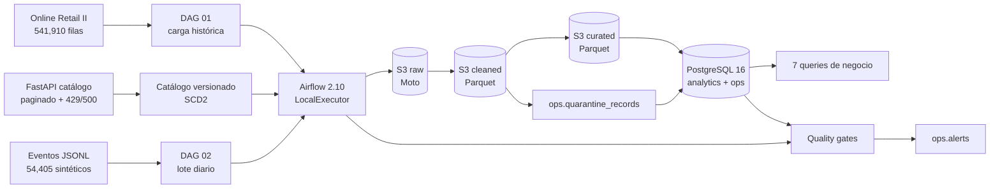
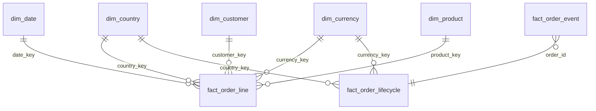

<h1 align="center">Mercado Nube</h1>

<p align="center">
  <strong>Plataforma de datos local-first para ventas, eventos de pedido y catálogo versionado.</strong><br/>
  De la ingesta a las preguntas de negocio: <code>raw → cleaned → curated</code>, modelo dimensional con SCD2,
  calidad con cuarentena y orquestación con Airflow.
</p>

<p align="center">
  
  
  
  
  
  
</p>

---

> [!IMPORTANT]
> **Demo local, sin gasto en AWS.** Todo el flujo se ejecuta con Docker, Moto (emulación S3) y PostgreSQL.
> La infraestructura AWS está descrita en Terraform y fue validada con `terraform validate`, pero **nunca se aplicó**.
> No se creó ningún recurso ni se usaron credenciales reales de AWS.

## Lo que demuestra este proyecto

- Ingesta de un histórico de ventas, eventos diarios y un catálogo versionado.
- Data lake local compatible con S3 y organizado por capas `raw → cleaned → curated` (Parquet).
- Airflow con dos DAGs: carga histórica y procesamiento diario incremental.
- Modelo dimensional en PostgreSQL con dimensiones, hechos, SCD2 y miembros desconocidos explícitos.
- Cuarentena, deduplicación, control de conflictos y *quality gates* antes y después de publicar.
- Idempotencia real ante reruns, recuperación tras fallas y soporte de eventos tardíos.
- Siete consultas de negocio versionadas y evidencia reproducible de cada resultado.
- Referencia AWS/IAM segura como código, validada sin `plan` ni `apply`.

## Resultados verificables

| Componente | Resultado local |
|---|---:|
| Histórico leído | **541,910** filas |
| Hechos de línea de factura | **534,130** |
| Eventos publicados | **31,589** |
| Órdenes en lifecycle | **19,330** |
| Versiones SCD2 de producto | **5,312** |
| Productos corrientes | **3,958** |
| Eventos tardíos | **1,076** (3.41%) |
| Filas en cuarentena | **2,545** |
| Quality gates | **80/80 pass** |
| Tests | **11/11 pass** |
| Terraform | `fmt` + `validate` OK, sin `apply` |

Reconciliación del histórico:

```text
541,910 leídas = 2,517 rechazadas + 5,263 duplicadas + 534,130 publicadas
```

La evidencia completa está en [`docs/evidencia.md`](docs/evidencia.md) y en los archivos crudos de [`docs/evidence/`](docs/evidence/).

## Arquitectura



### Equivalencia local → AWS

| Local | Referencia AWS | Decisión |
|---|---|---|
| Moto S3 | S3 versionado, SSE-S3 y lifecycle | Mismo contrato de llaves y cliente `boto3` |
| PostgreSQL 16 | Redshift / Redshift Serverless | Modelo y SQL compatibles; PostgreSQL evita costo local |
| Airflow LocalExecutor | MWAA | DAGs sin dependencia del scheduler local |
| FastAPI local | API real / Lambda / AppFlow | Simula paginación, rate limit y errores transitorios |
| Adminer | Consola SQL administrada | Solo comodidad para explorar datos |
| Terraform validado | Terraform aplicado con aprobación | Roles de despliegue y ejecución separados |

## Stack

| Capa | Tecnología |
|---|---|
| Orquestación | Apache Airflow 2.10, `LocalExecutor` |
| Procesamiento | Python, pandas, PyArrow |
| Data lake | S3 compatible con Moto, Parquet, checksums SHA-256 |
| Warehouse | PostgreSQL 16 (`staging`, `analytics`, `ops`) |
| API de catálogo | FastAPI + Uvicorn |
| Infraestructura como código | Terraform + AWS provider 5.x |
| Pruebas | pytest (unitarias e integración) |
| Contenedores | Docker Compose |

## Inicio rápido

Requisitos: Docker Desktop con Compose v2, PowerShell 7+ y ~4 GB de RAM libre.

```powershell
# 1. Crear la configuración local
Copy-Item .env.example .env

# 2. Construir y levantar el stack
docker compose up -d --build
docker compose ps
```

> `.env` contiene secretos locales y está excluido de Git. `.env.example` solo incluye valores de demostración.
> Cambia las claves si expones los puertos fuera de tu equipo.

### Servicios locales

| Servicio | URL / conexión | Credenciales de demo |
|---|---|---|
| Airflow | <http://localhost:8088> | `admin` / `admin123` |
| API de catálogo | <http://localhost:8001/docs> | — |
| PostgreSQL | `localhost:5433`, DB `mercado_nube` | `mn_app` / valor en `.env` |
| Adminer | <http://localhost:8082> | Usar conexión a `postgres` |
| Moto S3 | <http://localhost:9002> | `test` / `test` |

Al iniciar, Airflow aplica `sql/ddl.sql`, siembra dimensiones y crea el bucket local.

### Ejecutar la demo

```powershell
# Carga histórica + catálogo v1
docker exec mn_airflow airflow dags trigger 01_historical_load

# Lotes diarios publicados
docker exec mn_airflow airflow dags trigger 02_daily_events --conf '{"ingest_date":"2026-10-22"}'
docker exec mn_airflow airflow dags trigger 02_daily_events --conf '{"ingest_date":"2026-10-23"}'
docker exec mn_airflow airflow dags trigger 02_daily_events --conf '{"ingest_date":"2026-10-24"}'
```

O ejecuta el flujo completo y las verificaciones desde PowerShell:

```powershell
.\scripts\run_demo.ps1
.\scripts\run_queries.ps1
.\scripts\verify.ps1
```

`run_demo.ps1` es idempotente: reutiliza los mismos `batch_id` y llaves S3, y evita reprocesar lotes ya publicados.
Usa `-IncludeHistorical` o `-ForceDaily` para forzar una ejecución; `-SkipBuild` evita reconstruir las imágenes.

## Datos incluidos y capas

El repositorio incluye los datos de entrada para que la demo sea reproducible sin descargas adicionales:

- histórico público **Online Retail II** (UCI);
- lotes sintéticos de eventos en JSONL;
- versiones v1, v2 y v3 del catálogo.

Los scripts de `scripts/` permiten regenerarlos de forma determinista.

```text
raw/
  source=orders_historical/ingest_date=YYYY-MM-DD/batch_id=.../order_lines.csv
  source=order_events/ingest_date=YYYY-MM-DD/batch_id=.../events.jsonl
  source=catalog/ingest_date=YYYY-MM-DD/batch_id=.../catalog_vN.json

cleaned/
  source=.../batch_id=.../order_lines.parquet
  source=.../batch_id=.../events.parquet
  source=.../batch_id=.../quarantine.parquet
  source=.../batch_id=.../duplicates.parquet

curated/
  table=fact_order_event/...
  table=fact_order_lifecycle/...
  table=dim_product/...
```

Cada escritura local usa `ServerSideEncryption=AES256`. La referencia Terraform refuerza cifrado por defecto,
versionado, bloqueo de acceso público, TLS obligatorio y lifecycle por capa.

## Modelo dimensional



- **`dim_product`**: SCD2 por `sku` con `valid_from`, `valid_to`, `is_current`, `record_hash` y `catalog_version`.
- **`dim_customer`**: histórico más miembros desconocidos explícitos (`customer_key = -1`).
- **`fact_order_line`**: grano línea de factura; ventas y devoluciones con montos en USD.
- **`fact_order_event`**: grano evento, `UNIQUE(source, event_id)`, `is_late` y `late_hours`.
- **`fact_order_lifecycle`**: una fila por orden, recalculada con todo el historial de eventos.
- **Tablas operativas**: cuarentena, métricas por lote/capa, manifiestos, checksums, calidad y alertas.

Las dimensiones de país y moneda conservan miembros desconocidos `ZZ` y `XXX`; no se inventan clientes ni se
convierten valores faltantes en nulos silenciosos.

Detalle: [`docs/modelo_datos.md`](docs/modelo_datos.md).

## Calidad, idempotencia y eventos tardíos

### Quality gates

| Dominio | Checks | Resultado |
|---|---:|---|
| Histórico | 9 | 9/9 pass |
| Eventos (3 lotes) | 13 por lote | 39/39 pass |
| Catálogo (4 versiones) | 8 por versión | 32/32 pass |
| **Total** | **80** | **0 fallas** |

Se validan contratos, reconciliación de conteos, tasas de rechazo/duplicado, integridad de `event_id`,
joins a dimensiones, cobertura de lifecycle, frescura de ingesta y consistencia SCD2.

Si un gate falla, el run termina en `failed` y se registra una alerta. El lote ya publicado **no se revierte
automáticamente**: la corrección es explícita e idempotente.

### Idempotencia

- `batch_id` determinista: `historical_<fecha>`, `events_<fecha>`, `catalog_<fecha>_v<versión>`.
- S3 sobrescribe la misma llave y registra checksum SHA-256 en `ops.batch_manifest`.
- Histórico: `DELETE` por `batch_id` + inserción transaccional.
- Eventos: `UNIQUE(source, event_id)` + `ON CONFLICT`.
- Lifecycle: upsert por `(source, order_id)`, recalculado con todo el historial.
- Un rerun del mismo lote no duplica hechos ni altera los checksums de ese lote.

### Eventos tardíos

Un evento es tardío cuando `ingested_at - event_time_utc > 24 h`. Al publicar, se recalculan **todas** las
órdenes afectadas, no solo el evento nuevo. Esto permite que un `paid` tardío actualice correctamente el
lifecycle y `time_to_pay_hours`.

Resultado: **1,076 eventos tardíos (3.41%)** y **1,068 órdenes** afectadas.
La frescura del gate mide `ingested_at`; ser tardío no implica rechazo automático.

Detalle: [`docs/calidad.md`](docs/calidad.md).

## Preguntas de negocio

Las siete consultas están en [`sql/queries/`](sql/queries/) y sus resultados completos en
[`docs/evidence/sql_results.txt`](docs/evidence/sql_results.txt).

| # | Pregunta | Hallazgo principal |
|---|---|---:|
| 1 | Ventas, devoluciones y neto por mes/país/moneda | Dic-2010 UK: neto **USD 1,045,686.90** |
| 2 | Ingresos y devoluciones por categoría | General neto **USD 5.70 M** |
| 3 | Top 10 SKU por venta neta | `22423` Regency Cakestand: **USD 261,799.48** |
| 4 | Tiempo a pago y cancelación | Perú: pago medio **17.90 h**, cancelación **7.47%** |
| 5 | Eventos tardíos y reprocesamiento | **1,076** tardíos; **1,068** órdenes afectadas |
| 6 | Rechazo por fuente y motivo | Histórico **0.4645%**; eventos **0.0878%** |
| 7 | Historia de atributos del catálogo | SKUs con 3 versiones y cambios de categoría |

## Evidencia y verificación

| Evidencia | Archivo |
|---|---|
| Conteos finales y métricas por lote | [`final_counts.txt`](docs/evidence/final_counts.txt) |
| Resumen de verificación | [`verify.txt`](docs/evidence/verify.txt) |
| Tests unitarios | [`pytest_unit.txt`](docs/evidence/pytest_unit.txt) |
| Tests de integración | [`pytest_integration.txt`](docs/evidence/pytest_integration.txt) |
| Prueba de idempotencia | [`idempotency.txt`](docs/evidence/idempotency.txt) |
| Falla y recuperación | [`failure_recovery.txt`](docs/evidence/failure_recovery.txt) |
| Resultados SQL | [`sql_results.txt`](docs/evidence/sql_results.txt) |
| SSE-S3 local | [`s3_sse.txt`](docs/evidence/s3_sse.txt) |
| Terraform | [`terraform_validate.txt`](docs/evidence/terraform_validate.txt) |

Comandos de verificación:

```powershell
# Tests unitarios
docker exec mn_airflow python -m pytest tests -m "not integration" -q

# Tests completos + queries (requiere stack y datos)
docker exec -e RUN_INTEGRATION_TESTS=1 mn_airflow python -m pytest tests -q

# Conteos y quality gates
.\scripts\verify.ps1

# Regenerar evidencia SQL
.\scripts\run_queries.ps1
```

## AWS y Terraform

La carpeta [`terraform/`](terraform/) es una referencia **AWS-ready**, no un despliegue:

- bucket S3 con versionado, SSE-S3, bloqueo público, TLS obligatorio y lifecycle;
- rol de ejecución para MWAA y rol de despliegue separado;
- CloudWatch Logs, metric filter de errores, topic SNS y alarmas;
- MWAA opcional con `enable_mwaa=false` por defecto.

```powershell
cd terraform
terraform init -backend=false
terraform fmt -check
terraform validate
```

> `init` descarga el provider y no requiere credenciales. `validate` no crea recursos.
> **No se ejecutó `plan` ni `apply`.** La demo no tiene costo AWS.

El rol de despliegue administra infraestructura del proyecto, pero no puede leer ni escribir objetos del
bucket de datos. El rol de ejecución solo accede al bucket, logs y métricas de MWAA. Los detalles y la ruta
de despliegue autorizada están en [`terraform/README.md`](terraform/README.md).

## Estructura del repositorio

```text
api/                 FastAPI del catálogo: paginación, rate limit y errores transitorios
config/              Países, aliases, monedas y tasas DEMO
dags/                DAG 01 histórico y DAG 02 diario
data/                Histórico, eventos y catálogo de la demo incluidos
docker/              Imagen de Airflow y bootstrap de PostgreSQL
docs/                Arquitectura, modelo, calidad, operación y evidencia
scripts/             Generación, demo, queries y verificación
sql/                 DDL y siete consultas de negocio
src/                 Pipelines, calidad, storage, cliente API y generador
terraform/           S3 + IAM + CloudWatch + MWAA opcional (solo validado)
tests/               Pruebas unitarias e integración
```

## Costos aproximados y limpieza

**No se creó ningún recurso AWS en esta entrega.** Los valores siguientes son supuestos de laboratorio en
`us-east-1` para dimensionar, no una cotización.

| Recurso | Supuesto | Costo aproximado |
|---|---|---:|
| Local (Docker + Moto + PostgreSQL) | Laptop, sin AWS | **USD 0** |
| S3 Standard | 10 GB, lifecycle a IA/expiración | ~USD 0.23/mes + requests |
| CloudWatch Logs | 1 GB ingerido, retención 30 días | ~USD 0.80/mes |
| MWAA | `mw1.small`, 730 h | ~USD 360/mes (referencia) |
| Redshift Serverless | 8 RPU mínimo, si se habilita | ~USD 2.88/h (referencia) |

Por eso `enable_mwaa=false` es el valor por defecto. Para un laboratorio autorizado, define AWS Budgets y
destruye los recursos al terminar.

```powershell
# Detener conservando volúmenes (base y logs siguen disponibles)
docker compose down

# Destructivo: elimina base, logs y artefactos locales del proyecto
docker compose down -v
```

## Decisiones y límites

- **Sin Spark, Glue ni dbt:** el volumen del MVP no justifica un motor distribuido. pandas + PyArrow deja
  Parquet como contrato para una futura migración.
- **PostgreSQL como warehouse local:** reproduce el modelo, constraints y SQL de ventanas sin costo.
- **Moto en vez de MinIO:** mantiene el mismo contrato de S3 y permite validar cifrado y versionado.
- **Datos separados en el tiempo:** el histórico es de 2010–2011 y los eventos son de 2026; se documentan
  como hechos separados, no como una única serie temporal.
- **Tasas DEMO:** no son una fuente financiera real.
- **Batch incremental, no streaming:** el patrón es idempotente y reprocesable; CDC/streaming queda fuera del MVP.
- **Terraform no aplicado:** validar no equivale a desplegar. `enable_mwaa=false` evita costos accidentales.

## Documentación

- [Arquitectura](docs/arquitectura.md) — componentes, flujos y decisiones.
- [Modelo de datos](docs/modelo_datos.md) — granos, claves, SCD2 y ciclo de orden.
- [Calidad](docs/calidad.md) — reglas, umbrales y semántica.
- [Operación](docs/operacion.md) — runbook, fallas, recuperación y comandos.
- [Evidencia](docs/evidencia.md) — resultados, checksums, run IDs y salidas.
- [Terraform](terraform/README.md) — referencia AWS e IAM.

## Créditos

El histórico utilizado es el dataset público **Online Retail II** del
[UCI Machine Learning Repository](https://archive.ics.uci.edu/dataset/502/online+retail+ii).
Los eventos y las versiones del catálogo son datos sintéticos generados de forma determinista para esta demo.
