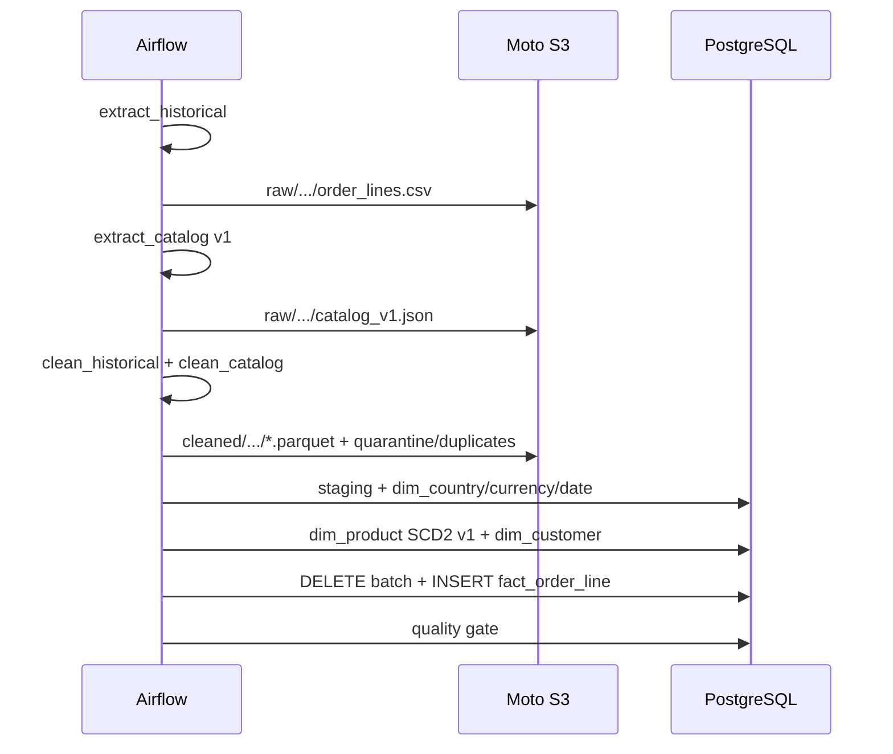
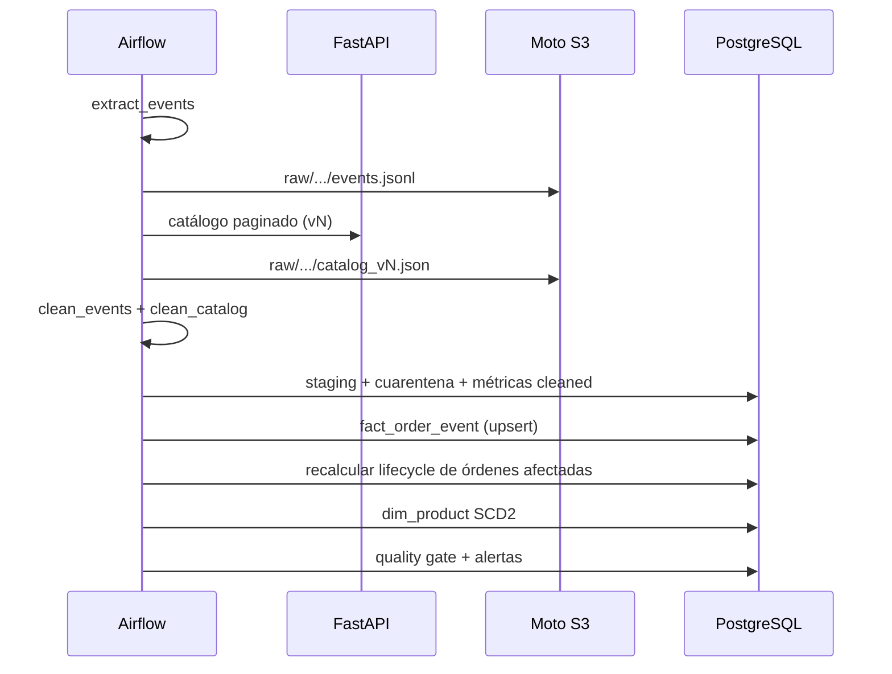
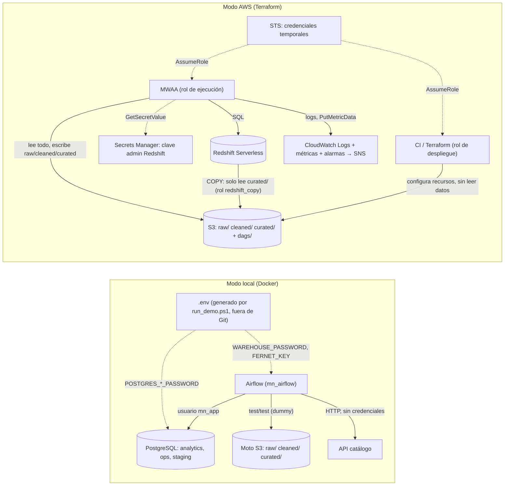

# Arquitectura

## Objetivo

Construir un MVP local de una plataforma de datos para Mercado Nube que:

1. Ingeste un histórico grande, eventos diarios y un catálogo versionado.
2. Mantenga capas `raw → cleaned → curated`.
3. Publique un modelo dimensional en un warehouse SQL.
4. Controle calidad, rechazos, duplicados y conflictos.
5. Sea idempotente ante reruns y tolere eventos tardíos.
6. Responda siete preguntas de negocio.
7. Tenga una referencia AWS/IAM sin gastar ni aplicar recursos.

## Restricciones que guiaron el diseño

- **Solo local:** no hay credenciales ni recursos AWS en la demo.
- **No interferir con otros proyectos Docker:** proyecto Compose `mercado-nube`, contenedores `mn_*`, volúmenes propios.
- **Tiempo:** 6 horas; se prioriza claridad y verificabilidad sobre herramientas distribuidas.
- **Contratos estables:** S3, Parquet, SQL y DAGs deben poder migrar a AWS sin reescribir la lógica de negocio.

## Componentes

| Componente | Implementación | Responsabilidad |
|---|---|---|
| Orquestación | Airflow 2.10, LocalExecutor | Ordenar extracción, limpieza, publicación, calidad y alertas |
| Data lake | Moto S3 | Buckets/objetos con llaves Hive; checksums SHA-256 |
| Warehouse | PostgreSQL 16 | Esquemas `staging`, `analytics`, `ops`; SQL compatible con el modelo |
| API de catálogo | FastAPI | 40 páginas, rate limit 40 req/10 s, 500 transitorio por página |
| Generador | Python, seed 42 | 54,405 eventos sintéticos deterministas |
| BI/ad hoc | psql | Siete queries de negocio versionadas |
| IaC | Terraform | S3/IAM/CloudWatch y MWAA opcional; solo se valida |

### Puertos

| Servicio | Host | Contenedor |
|---|---:|---:|
| Airflow | 8088 | 8080 |
| PostgreSQL | 5433 | 5432 |
| Moto S3 | 9002 | 5000 |
| API catálogo | 8001 | 8000 |
| Adminer | 8082 | 8080 |

## Flujo histórico (DAG 01)



Puntos importantes:

- `extract_historical` calcula checksum y publica el CSV en `raw/`.
- La limpieza normaliza país, fechas y montos; valida y separa cuarentena/duplicados.
- `publish_historical_dimensions` carga dimensiones, catálogo v1 y clientes.
- `publish_historical_facts` inserta hechos con `product_key` histórico y `country_key`/`currency_key`; la conversión USD usa `ops.exchange_rates`.
- El quality gate corre al final: reconcilia lo ya publicado y deja el DAG en `failed` con alerta si no cuadra; no revierte automáticamente los hechos escritos.

## Flujo diario (DAG 02)



- `publish_events` publica el Parquet curado de hechos y lifecycle.
- El catálogo se resuelve por fecha: v2 el 2026-10-22, v3 desde 2026-10-23. `catalog_version=0` significa “resolver por fecha”.
- Una orden puede recibir eventos en lotes distintos; el lifecycle se recalcula con todo el historial.
- La tarea de calidad corre al final: si falla, el run queda `failed` y se genera alerta; la corrección/replay es explícita e idempotente.

## Capas S3

```text
raw/
  source=orders_historical/ingest_date=2026-10-21/batch_id=historical_2026-10-21/order_lines.csv
  source=order_events/ingest_date=2026-10-22/batch_id=events_2026-10-22/events.jsonl
  source=catalog/ingest_date=2026-10-23/batch_id=catalog_2026-10-23_v3/catalog_v3.json

cleaned/
  source=.../batch_id=.../order_lines.parquet
  source=.../batch_id=.../events.parquet
  source=.../batch_id=.../quarantine.parquet
  source=.../batch_id=.../duplicates.parquet

curated/
  table=fact_order_event/...
  table=fact_order_lifecycle/...
  table=dim_product/...
```

Los prefijos Hive permiten particionar por fecha y lote sin cambiar el código. Cada `put_object` local envía `ServerSideEncryption=AES256`; en AWS Terraform además fuerza cifrado por defecto del bucket. El lifecycle de S3 reduce costo de capas antiguas.

## Decisiones de diseño

### ¿Por qué pandas/PyArrow y no Spark/Glue?

Volumen del MVP: 541,910 filas históricas + ~54k eventos en 7 lotes. Un motor distribuido añade costo, latencia de desarrollo y superficie de fallo. pandas + PyArrow procesa por lote en segundos y deja Parquet como contrato para un futuro Glue/EMR.

### ¿Por qué PostgreSQL y no Redshift local?

PostgreSQL reproduce el modelo dimensional, constraints, transacciones y SQL de ventanas, y Redshift Serverless no corre localmente sin costo. El DDL local **no** es directamente compatible con Redshift (`serial`, `jsonb`, `ON CONFLICT`, FKs que Redshift no hace cumplir), por eso existe una versión propia en `sql/redshift/ddl_redshift.sql` con `DISTKEY`/`SORTKEY`, `SUPER` y carga `COPY` + `MERGE` (`sql/redshift/load_from_s3.sql`). Las 7 consultas de negocio sí usan SQL estándar (`CASE`, ventanas, `PERCENTILE_CONT`) que Redshift soporta.

### ¿Por qué Moto?

Moto implementa la API de S3 con el mismo cliente `boto3` que se usaría en AWS, así el código no cambia entre modos (solo `S3_ENDPOINT_URL`). Límites: guarda los objetos en memoria (si el contenedor se reinicia, el lake local se vacía y se regenera re-ejecutando los DAGs desde `data/`) y no cifra de verdad: solo acepta el encabezado `ServerSideEncryption`. El cifrado real, el versionado y el lifecycle están en Terraform.

### ¿Por qué la API tiene errores simulados?

El cliente debe demostrar resiliencia: reintentos con backoff ante 429/500, sin perder páginas ni duplicar catálogo. La API falla una vez por página 17 y 34 por versión, y aplica rate limit; el pipeline reintenta y termina.

### ¿Cómo se configuran reintentos y timeouts?

Los DAGs usan `PIPELINE_RETRIES` (2 por defecto), `PIPELINE_RETRY_DELAY_SECONDS` (30 s), backoff exponencial, `max_retry_delay` de 10 minutos, `execution_timeout` por tarea (1 h diario, 2 h histórico), `max_active_runs=1`, `max_active_tasks=4` y `dagrun_timeout`. La política se puede cambiar por entorno sin editar el DAG. Las fallas simuladas siguen siendo visibles: si se agotan los reintentos, el run queda `failed` y la recuperación manual es idempotente. La evidencia de fallo se capturó con una política de 0 reintentos para no esperar el backoff; la configuración entregada usa 2.

## Observabilidad y alertas

- **Local:** Airflow UI muestra el estado de cada tarea; `ops.pipeline_run_metrics` registra filas por lote/capa; `ops.data_quality_results` y `ops.alerts` guardan checks y fallas; `docs/evidence/verify.txt` resume el estado.
- **AWS (Terraform):** CloudWatch Logs con retención configurable, metric filter de `ERROR`, alarma `PipelineErrors` ≥ 1 en 5 minutos, alarma de `DAGProcessingErrors` de MWAA y alarma de `SchedulerHeartbeat` ausente. Todas publican a un topic SNS (`alerts_topic_arn`) que el equipo suscribe a su canal.
- **Criterios de calidad:** el gate falla por tasas sobre umbral, reconciliación rota, FKs faltantes, SCD2 inválido, frescura de ingesta o lifecycle incompleto. Un fallo genera alerta y el DAG termina en `failed`; no se marca el lote como saludable.
- **Frescura:** `event_freshness` mide `ingested_at` contra el cierre del día; la latencia de eventos se monitorea con `late_event_ratio_informative`, sin confundirla con retraso de ingesta.

## Seguridad y aislamiento

- Credenciales solo por `.env`; `.env` está en `.gitignore`.
- Moto usa credenciales dummy `test/test`; no hay secretos AWS reales.
- Terraform no se aplica; el bucket tiene bloqueo público, TLS obligatorio, versionado y cifrado.
- IAM de ejecución MWAA: solo S3 del data lake, logs y métricas MWAA. IAM de despliegue separado: solo recursos del proyecto, sin acceso a datos de negocio.
- El proyecto Compose está aislado; no se eliminan contenedores/imágenes de otros proyectos.

## Ruta a AWS

1. Crear bucket con `terraform apply` (cuando exista aprobación y presupuesto).
2. Subir DAGs a `s3://bucket/dags/` y requirements a `requirements/`.
3. Crear MWAA con `enable_mwaa=true` y VPC/subredes/SGs.
4. Reemplazar PostgreSQL por Redshift y adaptar `src/db.py` al driver/endpoint.
5. Mantener Moto solo para tests locales; en AWS usar el endpoint S3 real.
6. Configurar Secret Manager/SSM para credenciales y un schedule de producción.

No se ejecutó `terraform apply` ni se creó ningún recurso AWS.

## Credenciales y accesos

Dónde viven los datos, cómo circulan las credenciales y quién accede a qué. Las líneas punteadas son credenciales; las continuas, acceso a datos.



| Componente | Credencial | Recurso | Acceso |
|---|---|---|---|
| Airflow local | `.env` → variables de entorno del contenedor | PostgreSQL (`mn_app`) | lectura/escritura en `staging`, `analytics`, `ops` |
| Airflow local | `test/test` (Moto, no son claves reales) | S3 local | lectura/escritura del bucket local |
| MWAA | rol de ejecución vía STS (sin access keys) | S3 | lee bucket; escribe solo `raw/`, `cleaned/`, `curated/` |
| MWAA | rol de ejecución | Secrets Manager | solo el secreto del admin de Redshift |
| MWAA | rol de ejecución | CloudWatch | sus log groups `airflow-<amb>-*` y métricas `MercadoNube/Pipeline` |
| Redshift | rol `redshift_copy` | S3 | solo lectura de `curated/` |
| Terraform/CI | rol de despliegue | infraestructura del proyecto | crear/actualizar; sin acceso a objetos de datos |

Ningún secreto se guarda en el repositorio, en las imágenes Docker, en Airflow Variables ni en los logs (`run_demo.ps1` tampoco imprime contraseñas).
