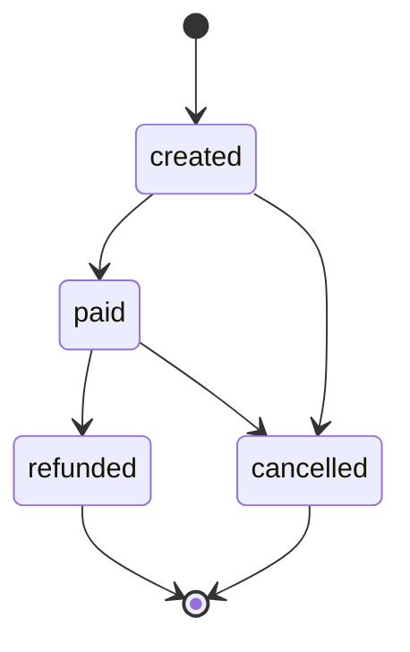

# Modelo de datos

## Esquemas

| Esquema | Uso | Ejemplos |
|---|---|---|
| `staging` | Aterrizaje de la limpieza para publicación; todo texto para COPY | `staging.order_lines`, `staging.events`, `staging.catalog`, `staging.customers` |
| `analytics` | Modelo dimensional y hechos | `dim_*`, `fact_*` |
| `ops` | Observabilidad y control | cuarentena, métricas, manifiestos, calidad, alertas, tasas |

## Dimensiones

### `analytics.dim_date`

- Grano: un día.
- Clave: `date_key` entero `YYYYMMDD`.
- Atributos: fecha, año, mes, nombre de mes, trimestre, semana, día de semana.
- Se siembra para 2010–2027.

### `analytics.dim_country`

- Clave: `country_key` serial.
- Código ISO-2 `country_code` único, nombre y región.
- Miembro desconocido explícito: `ZZ` con `country_key=0`.
- No se crean países por texto libre; el validador mapea aliases de `config/country_aliases.csv` y códigos ISO válidos.

### `analytics.dim_currency`

- Clave: `currency_key` serial.
- ISO-3 único; `is_reporting` marca USD.
- Miembro desconocido explícito: `XXX` con `currency_key=0`.
- La tasa USD vive en `ops.exchange_rates`; no en la dimensión.

### `analytics.dim_customer`

- Clave: `customer_key` bigserial.
- `(source, source_customer_id)` único.
- Cliente desconocido: `customer_key=-1`, `is_unknown=true`.
- El histórico no inventa identidad: si `customer_id` está vacío, se usa `-1`.

### `analytics.dim_product` — SCD2

- Grano: una versión de un SKU.
- Clave: `product_key`; único `(sku, valid_from)`.
- Atributos versionados: `product_name`, `category`, `is_service`, `is_active`.
- Control: `valid_from`, `valid_to`, `is_current`, `catalog_version`, `record_hash`, `updated_at`.
- Miembro desconocido: `product_key=0`, `sku='__UNKNOWN__'`.
- `record_hash` se calcula con SKU, nombre, categoría, `is_service` e `is_active`; si no cambia, no se crea versión.
- La fecha abierta interna es `9999-12-31`; el API usa `2100-12-31` para no salir del rango de pandas.

Timeline del catálogo:

| Versión | `valid_from` | Productos | Cambios |
|---|---|---:|---:|
| v1 | 2010-01-01 | 3,958 | carga inicial |
| v2 | 2026-10-22 | 3,958 | 395 categorías/nombres/activo |
| v3 | 2026-10-23 | 3,958 | 959 cambios acumulados |

Distribución final:

| `catalog_version` | Cerradas | Corrientes |
|---|---:|---:|
| 1 | 965 | 2,993 |
| 2 | 389 | 6 |
| 3 | 0 | 959 |

Total: 5,312 versiones, 3,958 corrientes. 0 duplicados corrientes; 0 pares con solapamiento temporal.

## Hechos

### `analytics.fact_order_line`

- Grano: una línea de factura histórica.
- PK: `line_key` (hash determinista de la fila limpia).
- FKs: producto (versión vigente), cliente, país, moneda, fecha.
- Medidas: `quantity`, `unit_price`, `gross_amount`, `return_amount`, `net_amount` y sus equivalentes USD.
- `line_type`:
  - `sale`: cantidad positiva, `gross_amount_usd > 0`.
  - `return`: factura `C` o cantidad negativa; `return_amount_usd` positivo; `net_amount_usd` negativo.
- `gross_amount_usd`, `return_amount_usd`, `net_amount_usd` se calculan con la tasa DEMO de `rate_date`.
- `record_hash` permite auditoría y deduplicación. `created_at` es el timestamp de ingesta (equivalente a `ingested_at`); `source` y `batch_id` identifican el origen y el lote.

Reconciliación histórica:

```text
541,910 leídas
 - 2,517 rechazadas (cuarentena)
 - 5,263 duplicadas exactas
 = 534,130 hechas publicadas
```

### `analytics.fact_order_event`

- Grano: un evento de una orden.
- PK: `event_key`; único `(source, event_id)`.
- FKs: país y moneda del evento.
- Tiempo: `event_time_utc`, `event_time_original`, `ingested_at`, `is_late`, `late_hours`.
- Medidas: `amount_original`, `amount_usd`.
- `record_hash` captura el contenido canónico; permite distinguir duplicado exacto de conflicto.
- `source` local es `events`; las métricas operativas usan `order_events`. La diferencia es deliberada: dominio vs. sistema fuente. La cuarentena y las métricas usan `order_events` para poder unirse entre sí.

### `analytics.fact_order_lifecycle`

- Grano: una orden por fuente.
- PK: `(source, order_id)`.
- Atributos: `created_at`, `paid_at`, `cancelled_at`, `refunded_at`, `first_event_at`, `last_event_at`, `current_status`, `was_cancelled`, `was_refunded`, `event_count`, `late_event_count`.
- `time_to_pay_hours = paid_at - created_at` en horas; nulo si falta algún hito.
- Se recalcula desde **todos** los eventos de las órdenes afectadas por un lote; un tardío puede completar el ciclo.
- `batch_id`/`updated_at` indican el último lote que lo recalculó.

Regla de estado:

```text
cancelled > refunded > paid > created
```

Una orden cancelada conserva `paid_at` si existió, pero `current_status='cancelled'`; `was_refunded` se marca si hubo `refunded`.

## Operaciones

### `ops.quarantine_records`

- `quarantine_key` único (SHA-256 con fuente, lote, registro, motivo y payload).
- `source`, `source_record_id`, `reason_code`, `reason_detail`, `raw_payload`, `batch_id`, `processed_at`, `record_hash`.
- Una fila por rechazo; `row_index` participa en la clave para no colapsar rechazos idénticos.
- La cuarentena se limpia por `batch_id` antes de reescribir el lote.

### `ops.pipeline_run_metrics`

- Clave `(batch_id, source, layer)`.
- Capas: `cleaned`, `published`, `curated` cuando aplica.
- Campos: `rows_read`, `rows_valid`, `rows_rejected`, `rows_duplicated`, `rows_late`, `rows_published`, `rows_conflicting`, tiempos y estado.
- Upsert idempotente.

Semántica especial:

- **Histórico/eventos:** `rows_published` son filas nuevas o ya publicadas del mismo lote; `rows_duplicated` son duplicados reales del archivo o de otros lotes.
- **Catálogo:** `rows_duplicated` mide SKU repetido en la misma foto; `rows_published` incluye productos sin cambio del snapshot (no crean versión SCD2, pero son filas aceptadas del lote).

### `ops.batch_manifest`

- Una fila por lote/fuente/capa.
- `object_path`, `row_count`, `checksum` SHA-256, `created_at`.
- Permite verificar que un rerun produjo los mismos bytes.

### `ops.data_quality_results`

- Único `(batch_id, check_name)`.
- `status`, `observed_value`, `threshold`, `details`, `checked_at`.
- Rerun hace upsert; no duplica resultados.

### `ops.alerts`

- `alert_key` único por lote/check.
- Se genera cuando un quality gate falla; incluye severidad y mensaje.

### `ops.exchange_rates`

- PK `(rate_date, from_currency, to_currency)`.
- Carga tasas DEMO 2010, 2011, 2026-01-01 y 2026-10-21.
- Todos los montos USD son reproducibles, pero **no representan cotizaciones reales**.

## Unknown members y calidad

| Caso | Representación | Se rechaza? |
|---|---|---|
| País no mapeable | `ZZ` / `country_key=0` | No, pero se monitorea |
| Moneda no mapeable | `XXX` / `currency_key=0` | No, pero se monitorea |
| Cliente histórico vacío | `customer_key=-1` | No |
| Producto no encontrado | `product_key=0` | No; se advierte |
| Precio ≤ 0 | Cuarentena `invalid_price` | Sí |
| Evento sin ID/orden/tipo | Cuarentena | Sí |
| `event_id` repetido con mismo hash | Duplicado | Sí, no se inserta |
| `event_id` repetido con hash distinto | Conflicto | Sí; gana la versión ya publicada |

La tasa de desconocidos explícitos se controla con `QUALITY_MAX_UNKNOWN_RATE` (5% por defecto). En el histórico fue 442/534,130 ≈ 0.08%, debajo del umbral.

## SCD2: algoritmo

1. Validar foto; normalizar SKU y booleanos.
2. Calcular `record_hash` de atributos.
3. Para cada SKU, comparar con la versión corriente:
   - Si `valid_from` es anterior a la versión corriente: snapshot fuera de orden; no se reabre historia y se cuenta como sin cambio.
   - No existe: insertar versión con `valid_from = snapshot_date`, `valid_to = 9999`.
   - Existe y hash igual: no-op.
   - Existe y hash distinto: cerrar la versión anterior en `snapshot_date - 1 µs` y insertar la nueva.
4. Exportar la tabla completa de versiones a `curated/table=dim_product`.
5. Verificar: un solo `is_current` por SKU, sin solapamientos.

## Ciclo de una orden



El estado final no borra hitos: una orden cancelada después de pagar conserva `paid_at`, pero `current_status='cancelled'`.

## Calendario y moneda

- Histórico: fechas 2010-12 a 2011-12, localizadas `Europe/London`, convertidas a UTC.
- Eventos: 2026-10-20 a 2026-10-26, timestamps UTC.
- Reporte: USD; tasas DEMO. El histórico original está en GBP; los eventos usan COP/MXN/PEN.
- No se mezclan series histórica y de eventos en una misma fact table; se comparan solo a nivel de modelo/negocio cuando tiene sentido.
